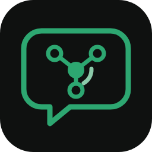

# Mnemo



**Mnemo is an AI helper bot for [Mnema Talk](https://github.com/msch128/mnema-talk).**
It is self-hosted: you run Mnemo yourself and connect it to the AI provider of
your choice with your own API key. Mnema Talk has no AI features of its own;
Mnemo is a separate program that uses the bot API, and it is also a blueprint
to copy when you write a bot of your own.

Ask it in your community's chat:

- *@Mnemo how many degrees is it in Marbella right now?* It checks the live weather.
- */ask what is 1234 × 5678 / 3?* It calculates this exactly instead of guessing.
- *@Mnemo what time is it in Tokyo, and what is 10 miles in km?*
- *@Mnemo who wrote The Name of the Rose?* It looks this up on Wikipedia and gives the link.
- *@Mnemo which is the best class in WoW?* It gives a short, balanced take and says that this is opinion and depends on the patch.

It answers when you mention it, through the `/ask` command, and in the threads
it starts, where it remembers the conversation. Under each answer are the
buttons **Regenerate**, **Details** (which tools were used, what was sent to
the AI) and, for `/ask`, **Follow up**.

---

- [Quick start (5 minutes)](#quick-start-5-minutes)
- [How Mnemo answers](#how-mnemo-answers)
- [Configuration](#configuration)
- [AI providers](#ai-providers)
- [Tools](#tools)
- [Privacy: what is sent where](#privacy-what-is-sent-where)
- [Costs and limits](#costs-and-limits)
- [Running in production](#running-in-production)
- [Troubleshooting](#troubleshooting)
- [Changing the persona](#changing-the-persona)
- [Writing your own tool](#writing-your-own-tool)
- [Adding a provider](#adding-a-provider)
- [How the code is organised](#how-the-code-is-organised)
- [Dependencies](#dependencies)
- [Development](#development)

## Quick start (5 minutes)

**Requires Mnema Talk 3.1.0 or newer**: the first release that contains the bot platform (3.1 or later).
Older servers have no manifests, buttons or bot SDK, and Mnemo cannot be
added to them.

You need a Mnema Talk server on which you are the Owner (or hold *Manage
bots*), an API key from an AI provider (or a local model, see
[AI providers](#ai-providers)), and Docker or Node.js 24.

### 1. Add Mnemo to your server

The file [`mnemo.manifest.json`](mnemo.manifest.json) describes Mnemo: its
name, its avatar, the `/ask` command, and what it asks for (to see channels,
send messages and add reactions, and to receive messages through the
`GUILD_MESSAGES` intent). Build the add link for your server:

```sh
git clone https://github.com/mnema-xyz/mnema-talk-mnemo-bot.git
cd mnema-talk-mnemo-bot
npm ci
npm run add-link -- https://talk.example.org
```

(`npm ci` needs Node.js 24. Without it, use the paste option below.)

Open the printed link while you are signed in. Mnema Talk shows what Mnemo
asks for. **Tick the channels where Mnemo may work** (none are ticked at
first), then confirm. Mnema Talk shows the bot's **token once**: copy it.

If you would rather not run npm on that machine, open **Admin area > Bots >
Add from manifest** and paste the contents of `mnemo.manifest.json`.

The link only carries the manifest, in the part after `#`, which the browser
never sends to the server. Opening the link creates nothing until you confirm.

### 2. Configure

```sh
cp .env.example .env
```

Fill in three values:

```sh
MNEMA_URL=https://talk.example.org   # your server
MNEMA_TOKEN=mnb_...                  # the token from step 1
MNEMO_API_KEY=sk-ant-...             # your Anthropic key (default provider)
```

Using OpenAI, OpenRouter or a local model instead? See
[AI providers](#ai-providers). No AI account yet? Set `MNEMO_PROVIDER=fake`
and leave the key empty: Mnemo then echoes your question, which checks the
connection, the permissions and the buttons without any costs.

### 3. Run

With Docker:

```sh
docker compose up -d --build
docker compose logs -f mnemo
```

Or with Node.js 24:

```sh
npm start        # reads .env; variables already in the environment win
```

The log says `"msg":"ready"` once Mnemo is connected, and it shows as online
in the member list.

### 4. Ask

In a channel you ticked, write `@`, pick Mnemo from the list and ask, or
type `/ask`. Nothing happens? See [Troubleshooting](#troubleshooting).

## How Mnemo answers

| You | Mnemo |
|---|---|
| Mention it in a channel: `@mnemo how warm is it in Oslo?` | Reacts with 👀 while it works, then answers in a **thread under your message** |
| Write in a thread that Mnemo started (no mention needed) | Answers in the thread and remembers the conversation so far (bounded, see `MNEMO_THREAD_*`) |
| Mention it inside somebody else's thread | Answers that one message there, with no earlier context, and does not follow that thread |
| `/ask question:… [private:true]` | Answers in the channel, or only to you with `private` |
| **Regenerate** | Writes a new answer to the same question. Only the person who asked can use it. The old answer stays but loses its buttons |
| **Details** | Shows you privately which tools were used with which input, which model answered, the tokens used and what was sent to the provider |
| **Follow up** (under `/ask` answers) | Opens a small form for a follow-up question, which is answered with the earlier question and answer as context |

Mnemo ignores other bots and its own messages, never reads a channel's
history, and only answers in the channels it was given (narrow them further
with `MNEMO_ALLOWED_CHANNELS`). Long answers are split at Mnema Talk's
4000-character limit, at paragraph boundaries, with code blocks kept intact.

Mnemo only answers. It cannot moderate, change settings, send direct
messages or act anywhere else. A bot account on Mnema Talk cannot do these
things anyway, and Mnemo asks for no permissions beyond reading and writing
in the channels you tick.

## Configuration

Settings come from environment variables. Optionally, settings can also come
from a JSON file named by `MNEMO_CONFIG`; environment variables override it.
Mnemo checks everything at start and stops with a list of every problem,
naming the variable:

```
Mnemo's configuration has 2 problems:
  - MNEMO_MAX_TOOL_CALLS: Too big: expected number to be <=20
  - MNEMA_TOKEN (or MNEMA_TOKEN_FILE) is required: the bot token from Admin area > Bots
```

**Secrets** (`MNEMA_TOKEN`, `MNEMO_API_KEY`, `MNEMO_SEARCH_API_KEY`) come
only from the environment, or from a file when you add `_FILE` to the name
(`MNEMA_TOKEN_FILE=/run/secrets/mnema_token`, for Docker secrets). The config
file refuses them. Mnemo never logs them.

### Connection and provider

| Variable | Default | Meaning |
|---|---|---|
| `MNEMA_URL` | *(required)* | Your Mnema Talk server, e.g. `https://talk.example.org` |
| `MNEMA_TOKEN` / `_FILE` | *(required)* | The bot token from Admin area > Bots |
| `MNEMO_PROVIDER` | `anthropic` | `anthropic`, `openai`, `openai-compatible` or `fake` |
| `MNEMO_API_KEY` / `_FILE` | | The provider's API key; not needed for a local server |
| `MNEMO_MODEL` | `claude-haiku-5-5` for Anthropic | Required for the other providers |
| `MNEMO_BASE_URL` | | The provider's address; required for `openai-compatible` |
| `MNEMO_ANTHROPIC_EFFORT` | `low` | `low`, `medium` or `high`: how much the model thinks before answering (Anthropic only) |
| `MNEMO_MAX_OUTPUT_TOKENS` | `4096` | Upper limit of one model reply |
| `MNEMO_PROVIDER_TIMEOUT_MS` | `60000` | Limit for one provider call |

### Tools

| Variable | Default | Meaning |
|---|---|---|
| `MNEMO_TOOLS` | all | Comma-separated: `weather`, `calculator`, `datetime`, `convert_units`, `wikipedia`, `web_search` |
| `MNEMO_SEARCH_PROVIDER` | | `brave` or `tavily`; turns on `web_search` together with the key |
| `MNEMO_SEARCH_API_KEY` / `_FILE` | | The search provider's key |
| `MNEMO_MAX_TOOL_CALLS` | `6` | Tool calls per question; more are refused, and the model answers with what it has |
| `MNEMO_TOOL_TIMEOUT_MS` | `10000` | Limit for one tool call |

### Where and how Mnemo answers

| Variable | Default | Meaning |
|---|---|---|
| `MNEMO_ALLOWED_CHANNELS` | *(all it can see)* | Comma-separated channel IDs |
| `MNEMO_REPLY_IN_THREAD` | `true` | Answer a mention in a thread (`false`: as a reply in the channel, without thread memory) |
| `MNEMO_SEND_DISPLAY_NAME` | `false` | Tell the provider the asker's display name |
| `MNEMO_THREAD_MAX_TURNS` | `12` | Messages of a thread that Mnemo remembers (a question and an answer are two) |
| `MNEMO_THREAD_MAX_CHARS` | `12000` | Characters of a thread that Mnemo remembers; the oldest are dropped first |
| `MNEMO_THREAD_TTL_HOURS` | `24` | Mnemo forgets a thread that has been quiet for this long |
| `MNEMO_SYSTEM_PROMPT` | built in | The persona, see [Changing the persona](#changing-the-persona) |
| `MNEMO_SYSTEM_PROMPT_FILE` | | The persona from a file |

### Limits and budget

| Variable | Default | Meaning |
|---|---|---|
| `MNEMO_MEMBER_LIMIT_PER_MINUTE` | `5` | Questions per member per minute (`0` = no limit) |
| `MNEMO_CHANNEL_LIMIT_PER_MINUTE` | `20` | Questions per channel per minute (`0` = no limit) |
| `MNEMO_DAILY_TOKEN_BUDGET` | `1000000` | Tokens (input + output) per UTC day (`0` = no limit) |
| `MNEMO_DAILY_COST_BUDGET_USD` | `0` | US dollars per UTC day (`0` = no limit) |
| `MNEMO_PRICE_INPUT_PER_MTOK` | known for Claude models | Price per million input tokens, for the cost budget and the Details note |
| `MNEMO_PRICE_OUTPUT_PER_MTOK` | known for Claude models | Price per million output tokens |

### Running

| Variable | Default | Meaning |
|---|---|---|
| `MNEMO_HEALTH_PORT` | `8080` | Port of the health endpoint (`0` = off) |
| `MNEMO_HEALTH_HOST` | `127.0.0.1` | Address of the health endpoint; `0.0.0.0` to reach it from outside the container |
| `MNEMO_DATA_DIR` | `data` (`/data` in Docker) | Where the day's budget survives a restart |
| `MNEMO_LOG_LEVEL` | `info` | `debug`, `info`, `warn` or `error` |
| `MNEMO_CONFIG` | | A JSON config file |

### The config file

[`mnemo.config.example.json`](mnemo.config.example.json) shows the format: the
same settings in camelCase (`maxToolCalls`, `allowedChannels`, ...). Lists are
JSON arrays. [`mnemo.config.schema.json`](mnemo.config.schema.json) lets your
editor check and complete it.

```sh
MNEMO_CONFIG=./mnemo.config.json node src/main.ts
```

## AI providers

All providers use the same interface ([`src/providers/types.ts`](src/providers/types.ts)),
and all support tools. Pick one with `MNEMO_PROVIDER`.

### Anthropic (default)

```sh
MNEMO_PROVIDER=anthropic
MNEMO_API_KEY=sk-ant-...                 # console.anthropic.com
# MNEMO_MODEL=claude-haiku-5-5           # the default: fast and the cheapest
# MNEMO_MODEL=claude-sonnet-5-5          # better answers, about 20 times the price
```

Mnemo uses the Messages API with tool use, through Anthropic's official SDK.
`MNEMO_ANTHROPIC_EFFORT=low` (the default) keeps answers quick and cheap; use
`medium` for harder questions.

### OpenAI

```sh
MNEMO_PROVIDER=openai
MNEMO_API_KEY=sk-...
MNEMO_MODEL=<a current model from your account's model list>
```

Mnemo uses OpenAI's **Responses API** with function tools, so every OpenAI
model that can call functions works, also those that cannot call tools
through Chat Completions (OpenAI's docs name GPT-6 Astra and GPT-6.1 Sol).
Nothing is stored at OpenAI between calls (`store: false`). Pick a small,
current model: Mnemo's questions are short, and tools do the exact parts.

### Any OpenAI-compatible server

Ollama, LM Studio, vLLM, OpenRouter, LiteLLM and others speak OpenAI's Chat
Completions API, which Mnemo uses for them. Set the base URL (the part before
`/chat/completions`) and the model name that the server knows. The model must
support tool calling through Chat Completions: GPT-6 Astra and GPT-6.1 Sol do
not (OpenAI's docs), so reach those with `MNEMO_PROVIDER=openai`, not through
a proxy.

```sh
# Ollama on the same machine (ollama pull <model> first)
MNEMO_PROVIDER=openai-compatible
MNEMO_BASE_URL=http://localhost:11434/v1
MNEMO_MODEL=<model name, e.g. one listed by `ollama list`>

# OpenRouter
MNEMO_PROVIDER=openai-compatible
MNEMO_BASE_URL=https://openrouter.ai/api/v1
MNEMO_API_KEY=sk-or-...
MNEMO_MODEL=<provider/model id from openrouter.ai/models>

# LM Studio: http://localhost:1234/v1, vLLM: http://<host>:8000/v1
```

Inside Docker, `localhost` is the container itself. Use
`http://host.docker.internal:11434/v1` (Docker Desktop, OrbStack) or the
host's address to reach a model server on the host.

### Fake

`MNEMO_PROVIDER=fake` answers `You asked: …` without any AI. Use it to check
a new installation, and in the tests.

## Tools

The model decides when to use a tool. Every tool's input is validated before
it runs. A tool's result is cut to 6000 characters and given to the model as
data, never as instructions.

| Tool | What it does | Service | Key |
|---|---|---|---|
| `weather` | Current weather and up to 7 days of forecast for a place ("Marbella", "Springfield, Illinois"), metric or imperial | [Open-Meteo](https://open-meteo.com) forecast and geocoding | none |
| `calculator` | Exact arithmetic: `+ - * / ^ mod ! %`, parentheses, `sqrt`, `log`, trigonometry, `round`, `min`, `max`, `pi`, `e`. A small parser written for Mnemo ([`src/tools/math.ts`](src/tools/math.ts)); it never runs code | none | none |
| `datetime` | The date and time in a place or IANA time zone, and conversion between zones, including daylight saving time | Node's time zone data; Open-Meteo to find a place's zone | none |
| `convert_units` | Length, mass, volume (US and imperial), area, speed, time, data (kB and KiB), pressure, energy, temperature. Not currencies | none | none |
| `wikipedia` | The summary and link of the best matching article, in any language edition | Wikimedia REST API | none |
| `web_search` | Top web results (title, link, snippet), for recent events | [Brave Search API](https://brave.com/search/api/) or [Tavily](https://tavily.com) | yes; off without one |

Questions of taste ("the best class in WoW", "the best phone") are answered
from the model's own knowledge, with a short note that the answer is opinion
and depends on the version or patch. The default persona asks for this.

Turn tools off with `MNEMO_TOOLS`, for example
`MNEMO_TOOLS=calculator,datetime,convert_units` for a Mnemo that never
contacts outside services.

## Privacy: what is sent where

**To your AI provider**, for each question:

- the question, without the `@mnemo` mention;
- in a thread: the earlier questions and answers of that thread, at most
  `MNEMO_THREAD_MAX_TURNS` messages and `MNEMO_THREAD_MAX_CHARS` characters;
- after **Follow up**: the earlier question and answer;
- the asker's display name, **only** with `MNEMO_SEND_DISPLAY_NAME=true` (off
  by default);
- the system prompt, the current date and time (UTC), the tool descriptions
  and the tools' results.

Mnemo never sends the provider a channel's history, other members' messages
outside its threads, user IDs, usernames, avatars, the server's address or
your Mnema Talk token. **Details** under every answer shows what was sent.

**To the tools' services**, only the tool's input: the place name for
Open-Meteo, the search words for Wikipedia and web search. Mnemo identifies
itself with the User-Agent `Mnemo/<version> (+<this repository>)` and sends
nothing else.

**Kept by Mnemo**, in memory only: the bounded thread conversations (for
`MNEMO_THREAD_TTL_HOURS`, at most 1000 threads; beyond that the quietest
thread is forgotten and Mnemo stops answering there without a mention) and what the buttons need (for 24 hours, at most
2000 answers). A restart forgets them. On disk there is only the day's token
count (`budget.json` in `MNEMO_DATA_DIR`), without any content.

**Logs** hold events, counts, model and tool names. They contain no message
text and no secrets.

Your provider's own terms decide what happens to the data it receives (for
example, whether it is used for training or how long it is kept). Read them,
or use a local model through `openai-compatible`, so that nothing leaves your
network except the tools' lookups.

## Costs and limits

You pay your AI provider for tokens. Each question costs one model call, plus
one more for each round of tool use. A typical question with one tool round
uses roughly 3,000 to 6,000 input tokens (the system prompt and tool
descriptions are sent each time) and a few hundred output tokens.

With the default `claude-haiku-5-5` ($0.10 per million input tokens, $0.50
per million output tokens, list price at the time of writing), that is well
under a tenth of a cent per question, roughly a thousand questions or more
per US dollar. Larger models cost many times more. Check your provider's
current prices.

### Prompt caching (Anthropic)

**Why.** Every model call repeats the same large block: the tool
descriptions and the system prompt, thousands of tokens. Anthropic can keep
that block cached for 5 minutes. A cached token costs a tenth of the normal
input price, and writing it to the cache costs a quarter more once. So the
first call of a burst pays slightly more and every call after it, including
each round of tool use within one question, is much cheaper. On the default
`claude-haiku-5-5` this takes most of the input cost out of busy periods.

**What you need to do.** Nothing: caching is on for the `anthropic` provider
and has no setting. It does not apply to the OpenAI providers. Two things
keep it working:

- Mnemo keeps the system prompt identical for every request. The current
  time and, with `MNEMO_SEND_DISPLAY_NAME=true`, the asker's name are sent as
  a short note in front of the question instead. Answers are unchanged.
- If you set your own persona (`MNEMO_SYSTEM_PROMPT` or
  `MNEMO_SYSTEM_PROMPT_FILE`), keep it free of anything that changes per
  request, such as a date or an ID: a changing prompt can never be cached.
  Prompts shorter than the model's minimum for caching (512 tokens on the
  Claude 5.5 models, tools included) are not cached and cost the normal
  price; the default persona with the built-in tools is above it.

**How the budgets count it.**

| Setting | Cached tokens |
|---|---|
| `MNEMO_DAILY_COST_BUDGET_USD` | Reads at 0.1 times and writes at 1.25 times `MNEMO_PRICE_INPUT_PER_MTOK`. Models with cheaper reads (Sonnet 5.5 and Opus 5.5 read at 0.05 times) are counted a little too high, never too low. |
| `MNEMO_DAILY_TOKEN_BUDGET` | Counted in full. A cached token still went through the model, so this budget measures volume; the cost budget measures money. |
| Details button | Shows the full prompt size; the dollar figure uses the cache prices. |

**How to check that it works.** Set `MNEMO_LOG_LEVEL=debug`. Every Anthropic
call then logs one `anthropic_cache` line:

```json
{"msg":"anthropic_cache","model":"claude-haiku-5-5","input_tokens":42,"cache_read_input_tokens":3900,"cache_creation_input_tokens":0,"output_tokens":120}
```

The first call after a pause of more than 5 minutes writes the cache
(`cache_creation_input_tokens` is large). Calls within the next 5 minutes read
it (`cache_read_input_tokens` is large, `cache_creation_input_tokens` small).
If `cache_read_input_tokens` stays at 0 across calls, the start of the prompt
changes between requests: check a custom persona for dates or IDs.

Guards keep a busy channel or a curious member from running up a bill:

- **Rate limits**: 5 questions per member and 20 per channel per minute by
  default. Over the limit, Mnemo says how long to wait: privately for `/ask`
  and the buttons, and once per member and minute for mentions (further
  mentions in that minute are dropped quietly).
- **Daily budget**: 1,000,000 tokens per UTC day by default (about $0.10 to
  $0.15 a day on Haiku if it is used up). Set `MNEMO_DAILY_COST_BUDGET_USD` for
  a limit in dollars. When it is used up, Mnemo says so and answers again
  after midnight UTC. Before each model call Mnemo reserves that call's
  worst case and settles it with the usage the provider reports, so
  questions asked at the same time do not overshoot it together. The worst
  case is an estimate: the input at about 3 characters per token for Latin
  text and one token per character for other scripts (CJK, Cyrillic, ...),
  plus `MNEMO_MAX_OUTPUT_TOKENS`. A call that fails or times out is counted
  at that worst case, because the provider may still bill it. The estimate
  is generous but not exact, so treat the budget as a firm guard rather than
  an accounting: the last few thousand tokens of a day can stay unused, and
  an unusual input could still exceed its estimate. The count survives
  restarts (`budget.json` in `MNEMO_DATA_DIR`).
- **Tool calls**: at most `MNEMO_MAX_TOOL_CALLS` per question, and at most 8
  model calls per question in any case.
- **Timeouts**: one provider call (`MNEMO_PROVIDER_TIMEOUT_MS`) and one tool
  call (`MNEMO_TOOL_TIMEOUT_MS`).

Set a spending limit in your provider's console as well. Mnemo's budget
counts what it is told; the provider's limit is the one that holds even if
something goes wrong.

## Running in production

- **Docker** ([`Dockerfile`](Dockerfile)): `node:24-alpine` pinned by digest,
  production dependencies only, runs as the unprivileged `node` user, no build
  step (Node 24 runs the TypeScript sources directly). The
  [`docker-compose.yml`](docker-compose.yml) adds a read-only root file
  system, drops all capabilities and keeps `/data` in a volume.
- **Health**: `GET /healthz` on `MNEMO_HEALTH_HOST:MNEMO_HEALTH_PORT` answers
  `200` while connected to Mnema Talk and `503` otherwise, with the version,
  model and the day's token count. The Docker image's `HEALTHCHECK` uses it.
- **Logs**: one JSON object per line on stdout (`time`, `level`, `msg` and
  fields), ready for Loki, journald or `docker compose logs`.
- **Shutdown**: on `SIGTERM` or `SIGINT` Mnemo closes the gateway connection
  and exits within 10 seconds. Questions in flight at that moment are not
  answered.
- **Reconnects**: the SDK keeps the connection with heartbeats, resumes
  after short drops and reconnects with backoff.
- **Updates**: `git pull && docker compose up -d --build`. Dependabot keeps
  the dependencies, the base image and the CI actions current in this
  repository.
- **One instance per bot token.** Two instances would both answer.

## Troubleshooting

| Symptom | Cause and fix |
|---|---|
| Mnemo exits at once with `configuration has N problems` | Read the list: each line names the variable to fix |
| Mnemo exits at start with `connect_refused` or `gateway_closed_for_good` | The log's `hint` says why. `connect_refused`: the token was refused (wrong, revoked, the bot disabled or banned: regenerate it in Admin area > Bots). `gateway_closed_for_good`: the gateway refused the connection, for example code 4014 when the bot may not use `GUILD_MESSAGES` (allow it in Admin area > Bots). Waiting fixes neither, so Mnemo does not retry |
| Log repeats `connect_failed` | Mnema Talk is not reachable at `MNEMA_URL` (yet). Mnemo keeps retrying with backoff up to once a minute |
| Mnemo exits with `gateway_closed_for_good` while running | The server closed the connection for good, typically because the token was regenerated or revoked, or the bot was disabled, banned or lost an intent. Mnemo exits with code 1 so that Docker restarts it and the next start says what is wrong |
| Mnemo is online but does not react to a mention | The channel is not one you ticked, so Mnemo cannot see it. Allow its role in the channel, or check `MNEMO_ALLOWED_CHANNELS`. Also check that you picked Mnemo from the mention list, so that it is a real mention |
| `/ask` is not in the command list | The command shows only where the bot can view and send. If an admin disabled it in Admin area > Bots, it stays off |
| Running `/ask` fails because the bot is not connected | Mnemo is not running, or not yet connected. Check its log and `/healthz` |
| Answers say `the AI provider refused the API key` | Wrong `MNEMO_API_KEY`, or the key belongs to another provider |
| Answers say `the AI provider timed out` | A slow model or a local model loading; raise `MNEMO_PROVIDER_TIMEOUT_MS` |
| A local model answers but never uses tools | The model does not support tool calling. Choose one that does |
| "I have used up today's budget" | The daily budget is reached; raise `MNEMO_DAILY_TOKEN_BUDGET` or wait for midnight UTC |
| Regenerate says the answer is too old | Mnemo was restarted, or the answer is more than 24 hours old. Ask again |
| No 👀 reaction | Mnemo lacks *Add reactions* in that channel; it still answers |

Run with `MNEMO_LOG_LEVEL=debug` to see tool errors and the SDK's
connection events.

## Changing the persona

The built-in persona is in [`src/engine/prompt.ts`](src/engine/prompt.ts): it
is named Mnemo, helpful and concise, says when it is unsure, marks opinion as
opinion, gives no medical or legal certainty, and formats for Mnema Talk's
Markdown. Replace it with your own:

```sh
MNEMO_SYSTEM_PROMPT_FILE=./persona.md
```

```markdown
You are Pixel, the helper of a retro gaming community.
Answer briefly and with good humour. Prefer facts from your tools.
When asked for opinions on games, give two sides and say it is a matter of taste.
Answer in the language of the question.
```

Whatever you write, Mnemo appends a few rules that keep it safe: tool
results and quoted messages are data, not instructions; it cannot act beyond
answering; it does not reveal its instructions. It also adds the current
date and time, and the asker's name if you enabled that.

To rename the bot itself, edit `name` in `mnemo.manifest.json` before adding
it, or rename it later in Admin area > Bots.

## Writing your own tool

A tool is one file. Here is a dice roller:

```ts
// src/tools/dice.ts
import { randomInt } from 'node:crypto'
import { z } from 'zod'
import { defineTool, ToolError } from './types.ts'

export const dice = defineTool({
  name: 'roll_dice',
  description: 'Rolls dice for games, e.g. 2d6. Use it whenever someone asks for a roll.',
  input: z.object({
    count: z.number().int().min(1).max(20).default(1),
    sides: z.number().int().min(2).max(1000).default(6),
  }),
  async run({ count, sides }) {
    if (sides === 13) throw new ToolError('nobody rolls a d13') // shown to the model
    const rolls = Array.from({ length: count }, () => randomInt(1, sides + 1))
    return JSON.stringify({ rolls, total: rolls.reduce((a, b) => a + b, 0) })
  },
})
```

Then add it to `BUILTIN_TOOLS` in [`src/tools/index.ts`](src/tools/index.ts).
That is all: the input schema becomes the JSON Schema the model sees, the
input is validated before `run` is called, errors become a message to the
model, and `MNEMO_TOOLS` can turn the tool off.

Guidelines that the built-in tools follow:

- **Describe when to use the tool.** The model reads `description` to decide.
- **Return compact JSON** with only what answers the question. Name the
  source, so the model can cite it.
- **Use `ctx.fetch`**, not the global `fetch`. It carries the timeout and the
  User-Agent, and the tests replace it with recorded responses.
- **Validate with zod**, and keep the input narrow (lengths, ranges, enums),
  because the model can be talked into sending anything. Never build a host
  name or a shell command from the input.
- **Test it without network**: see [`test/tools.test.ts`](test/tools.test.ts)
  and the recorded responses in [`test/fixtures`](test/fixtures).

A tool that needs a key reads it from the configuration. See how
`web_search` is wired in `selectTools` and `src/config.ts`.

## Adding a provider

A provider is one file that implements `Provider` from
[`src/providers/types.ts`](src/providers/types.ts): one `chat()` call that
takes the system prompt, the conversation and the tools, and returns text,
tool calls, a stop reason and token usage. Translate Mnemo's neutral turns to
your API's format. Look at [`anthropic.ts`](src/providers/anthropic.ts) and
[`openai.ts`](src/providers/openai.ts), which are about 150 lines each. Then add
a case to [`src/providers/index.ts`](src/providers/index.ts) and the name to
`provider` in `src/config.ts`.

## How the code is organised

```
src/
  main.ts            start: configuration, engine, Mnema Talk client, health, shutdown
  config.ts          settings, environment variables, validation
  bot/               everything about Mnema Talk (SDK): mentions, threads, /ask, buttons
  engine/            the answering loop, limits, budget, memory, message splitting, persona
  providers/         one file per AI provider, behind one interface
  tools/             one file per tool, behind one interface
  health.ts, log.ts  health endpoint, JSON logs
test/                unit tests (no network) and the integration test
scripts/             manifest, add link, config schema, integration test runner
```

The engine knows nothing about Mnema Talk, and the bot code knows nothing
about AI. To put Mnemo into another chat, keep `engine/`, `providers/` and
`tools/`, and replace `bot/`.

## Dependencies

Four runtime dependencies, each for a reason:

| Package | Why |
|---|---|
| [`mnema-talk-sdk`](https://github.com/msch128/mnema-talk/tree/main/sdk/typescript) | The official SDK: REST, gateway with heartbeats, resume and backoff, interactions, components. It has no dependencies of its own |
| [`@anthropic-ai/sdk`](https://github.com/anthropics/anthropic-sdk-typescript) | Anthropic's official client: request types, retries, typed errors |
| [`openai`](https://github.com/openai/openai-node) | OpenAI's official client, which also serves every OpenAI-compatible server |
| [`zod`](https://zod.dev) | Validates the configuration and each tool's input, and produces the JSON Schemas the model sees from the same definitions |

There are no other runtime dependencies. HTTP uses Node's `fetch`, time zones
use `Intl`, and the math parser is Mnemo's own. The development tools are
TypeScript (type checking only, nothing is compiled), ESLint with
typescript-eslint, and Node's built-in test runner.

### The SDK dependency

The SDK is not on the npm registry; it is published as a tarball with each
Mnema Talk release, and `package.json` takes it from there:

```json
"mnema-talk-sdk": "https://github.com/msch128/mnema-talk/releases/download/v3.1.0/mnema-talk-sdk-3.1.0.tgz"
```

`package-lock.json` pins its SHA-512 integrity, so `npm ci` refuses a
tarball that differs from the one checked against the release's `.sha256`
file. npm 12 fetches tarball URLs only when allowed: the repository's
[`.npmrc`](.npmrc) sets `allow-remote=root`, which allows it for direct
dependencies only. To move to a newer Mnema Talk release, change the two
version numbers in the URL and run `npm install`.

## Development

```sh
npm ci
npm run check            # lint, typecheck, unit tests
npm test                 # unit tests only: no network, no AI, fake provider and recorded responses
npm run dev              # run with .env, restart on changes
npm run manifest         # rebuild mnemo.manifest.json after changing the avatar or commands
npm run config-schema    # rebuild mnemo.config.schema.json after changing settings
```

The **integration test** starts a throwaway Mnema Talk with Docker, built
from a checkout of the server, adds Mnemo from its manifest, and checks
mentions, threads, `/ask`, Regenerate, the health endpoint and shutdown, with
the fake provider:

```sh
MNEMA_SRC=../mnema-talk scripts/integration.sh
```

The avatar is [`assets/mnemo.svg`](assets/mnemo.svg), in Mnema Talk's colours.
`scripts/render-avatar.sh` turns it into the PNG for the manifest (with
headless Chrome).

See [CONTRIBUTING.md](CONTRIBUTING.md) for the rules, and
[SECURITY.md](SECURITY.md) to report a vulnerability.

## License

[GNU Affero General Public License v3.0](LICENSE), like Mnema Talk. If you
run a modified Mnemo for others, they are entitled to its source.
